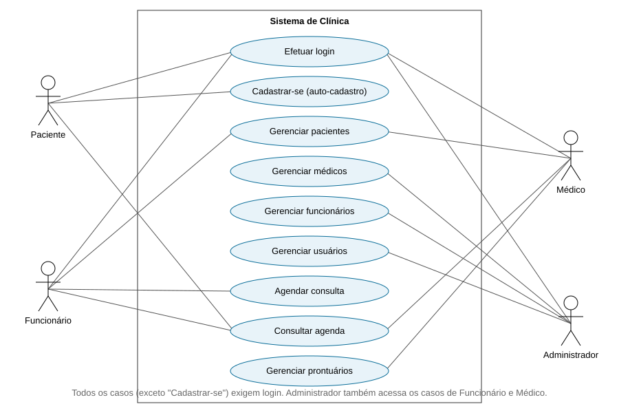

# 🏥 Sistema de Clínica (Spring Boot + HTML)

Sistema web para gerenciar **pacientes, médicos, funcionários, consultas e prontuários**, com **login obrigatório** e **auto-cadastro** para quem ainda não tem acesso.
Não precisa de XAMPP nem de MySQL instalado: usa o banco **H2** embutido (arquivo local `./data`).

## Requisitos de software
- **JDK 17+** ([Adoptium](https://adoptium.net))
- **Maven 3.8+** (ou abra o projeto no IntelliJ/Eclipse/VS Code, que já trazem o Maven)

## Como executar
```bash
git clone <URL-DO-SEU-REPOSITORIO>
cd clinica
mvn spring-boot:run
```
Acesse **http://localhost:8080** → será redirecionado para o login.

| Usuário inicial | Senha |
|---|---|
| `admin` | `admin123` |

Novo paciente: clique em **Cadastre-se** na tela de login.

## Perfis e permissões
| Perfil | Acessos |
|---|---|
| ADMIN | Tudo (inclui usuários, médicos e funcionários) |
| FUNCIONARIO | CRUD de pacientes e consultas |
| MEDICO | Consulta pacientes e agenda; CRUD de consultas e prontuários |
| PACIENTE | Somente visualiza as **próprias** consultas |

Para criar login de médico/funcionário: o ADMIN cria o **Usuário** (perfil correspondente) e o cadastro em **Médicos/Funcionários**, informando o mesmo login no campo *Login vinculado*.
Paciente sem login pode ser cadastrado por funcionário/admin; para ter acesso, faz o auto-cadastro ou o ADMIN cria o usuário.

## Entregas
| Item | Local |
|---|---|
| CRUD completo (6 entidades) | `src/main/java/com/clinica` + `src/main/resources/static` |
| Script SQL | `sql/script.sql` |
| Diagrama de caso de uso (SVG) | `docs/casos-de-uso.svg` |
| Documentação | este README |



## Documentação
### Arquitetura
- **Backend**: Spring Boot 3 (Web, Data JPA, Security), Lombok, H2.
- **Frontend**: HTML + JavaScript puro (`static/`), consumindo a API REST. Uma única tela (`index.html` + `app.js`) gera listagem e formulário de cada entidade.
- **Segurança**: login por formulário, senhas com BCrypt, regras por perfil em `config/SecurityConfig.java`. A API responde 401 sem login.

### Modelo de dados
```
usuario(id, login*, senha, perfil, ativo)
paciente(id, nome, cpf*, data_nascimento, telefone, email, login)
medico(id, nome, crm*, especialidade, telefone, login)
funcionario(id, nome, cpf*, cargo, telefone, login)
consulta(id, paciente_id→paciente, medico_id→medico, data_hora, motivo, status)
prontuario(id, consulta_id→consulta, descricao, diagnostico, prescricao)
```
`*` = único.

### API REST (CRUD)
Para cada recurso `{pacientes, medicos, funcionarios, consultas, prontuarios, usuarios}`:

| Método | Rota | Ação |
|---|---|---|
| GET | `/api/{recurso}` | Listar |
| GET | `/api/{recurso}/{id}` | Buscar |
| POST | `/api/{recurso}` | Criar |
| PUT | `/api/{recurso}/{id}` | Atualizar |
| DELETE | `/api/{recurso}/{id}` | Excluir |

Outras rotas: `POST /cadastro` (público), `GET /api/me`, `POST /login`, `GET /logout`.

### Banco de dados
- Padrão: H2 em arquivo (`./data/clinica`), tabelas criadas automaticamente.
- Para usar outro banco (PostgreSQL/MySQL) crie o banco, execute `sql/script.sql`, troque o driver no `pom.xml` e ajuste `application.properties` (`spring.datasource.*`).

## Subir para o GitHub
```bash
git init && git add . && git commit -m "Sistema de clínica"
git branch -M main
git remote add origin https://github.com/SEU-USUARIO/clinica.git
git push -u origin main
```

## Melhorias futuras
Ativar CSRF, validações de CPF/CRM, impedir conflito de horário do médico, paginação e testes automatizados.
